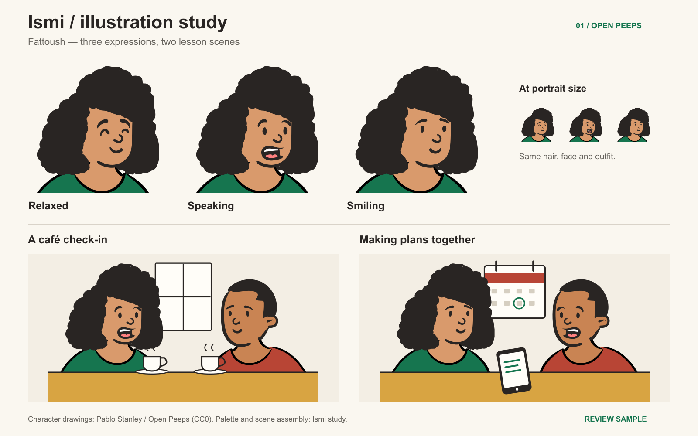

# Canva illustration sample

October 14, 2026 · F06.1 · Bounded sample complete; style approval pending

[Open the Canva sample](https://www.canva.com/design/DAHX9J-c6J8/R2nIW1DAhj2cy1ARExQonQ/edit)

## Delivered

One Fattoush style audition with relaxed, speaking and smiling expressions, plus
“A café check-in” and “Making plans together” lesson scenes. The same dark curly
hair, green clothing, skin palette and face construction recur throughout. The
companion is an unnamed scene partner, not an approved Knafeh redesign.

The Canva page is a full-page raster review board. Five separate SVG originals
(three portraits, two scenes) are also uploaded into Personal Uploads for reuse.
Local SVG sources, full-resolution PNGs and 64/96px portrait exports live in
[canva-sample-01](canva-sample-01/). Canva does not expose the board's text or
individual facial paths as separately editable objects. Edit vector source files
for detailed changes, or compose the separate uploads in Canva.

## Authorship and reproduction

Characters use Pablo Stanley's human-drawn [Open Peeps](https://www.openpeeps.com/),
released under CC0, via the pinned [DiceBear Open Peeps remix](https://www.dicebear.com/styles/open-peeps/)
version 10.6.0. This is a licensed library audition, not exclusive character ownership.
No image generator was used. `assemble.py` selects and recolors existing library
paths; scene props and layout are assembled from simple shapes. This does not
repeat the rejected custom SVG-path character drawing route.

[Provenance manifest](canva-sample-01/provenance.json) records the source URL,
version, retrieval date and SHA-256 hashes. The unchanged downloaded definition
is retained in `source/`. PNG rendering used Sharp from the bundled runtime.

## Canva account boundary

The browser exposes an Education team and Personal Free. Canva's
[Content License Agreement, section 8](https://www.canva.com/policies/content-license-agreement/)
restricts Pro Content obtained through Education to educational, non-commercial
use. Ismi has a planned freemium business model. This sample therefore uses our
uploaded CC0-source artwork in Personal and needs no Education Pro assets or upgrade.

## Verification and remaining decision

The board was visually inspected for matching silhouettes, palette, scene framing
and portrait-size comparison. A scene cropping issue was corrected before upload.
Canva visibly shows the fitted board and title “Ismi — character and lesson
illustration sample”; the File menu reported all changes saved after placement.
[Canva screenshot](canva-sample-01/canva-preview.png) records the final layout.

The owner should judge this visual direction before further production. These
expressions audition the style; final neutral/attentive/encouraging/profile state
mapping, Knafeh, accessibility, app fallback and offline checks remain open. No
app integration or application test run was needed for this review-only artifact.

## Delivery

Local sources and this note are uncommitted. The Canva review design is saved.
Nothing was pushed, deployed, or substituted into the existing `ismi-cast-v1`
registry. Historical rejected studies remain excluded from integration.
