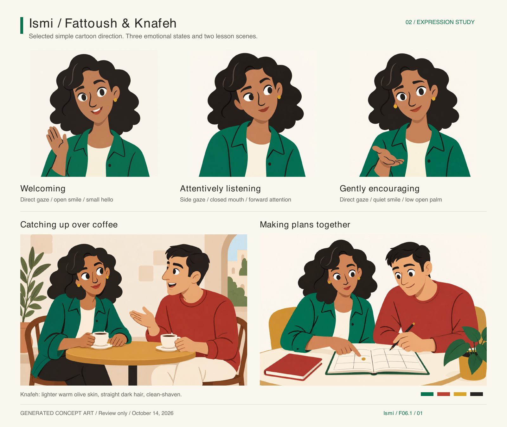
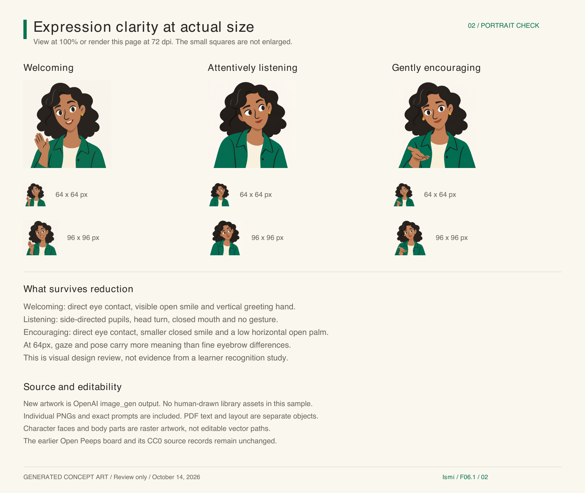

# Fattoush & Knafeh / expressive review 02

October 14, 2026 · F06.1 · Review sample completion checkpoint.

**Subsequent authorization:** the owner later requested app integration. See
[current v2 integration and verification](../app-art-v2/README.md). The review-only
delivery boundary below records this sample's earlier completion checkpoint.

[Canva review board](https://www.canva.com/d/ZaRlwUi4pRg3X7R) ·
[Interactive local review](review.html) · [PDF](review-board.pdf) ·
[Provenance](provenance.json) · [Exact prompts](prompts.json)



## Selected direction

The owner selected the least-detailed graphic version after seeing detailed,
simplified and intermediate trials. Fattoush retains her dark wavy hair, green
clothing and warm adult personality. Large eyes, bold brows, a broad hair
silhouette and restrained gestures carry the acting. Green, red and gold recur
in both scenes. This is generated concept artwork, not human-drawn source art.

The owner subsequently specified Knafeh as a lighter-skinned Palestinian Arab man
with straight hair and no facial hair for representation. Both scenes now use
that brief. This is an individual fictional design, not a Palestinian appearance
standard. The earlier bearded scene partner is superseded for this sample.

## Artwork and editability

- Three full-size 1254 x 1254 PNG portraits: `fattoush-welcoming.png`,
  `fattoush-listening.png`, `fattoush-encouraging.png`.
- Each portrait also has separate 64 x 64 and 96 x 96 PNG exports.
- Two 1536 x 1024 PNG scenes: `lesson-coffee.png`, `lesson-plans.png`.
- `review-board.pdf` has two pages: visual overview and size comparison.
- `review.html` provides actual CSS-pixel sizes and an optional hide-labels
  button for judging expressions without their names.
- `build_review.py` is the editable board/layout source. It composes existing
  rasters and text; it does not draw or trace character paths.
- Canva import retains separate image placements and editable text. The character
  drawings themselves are raster images; there are no invented SVG or layered
  illustrator originals. Detailed/middle trials remain under `alternates/`.

Rebuild with the bundled Python runtime containing ReportLab and Pillow:

```sh
python3 docs/characters/fattoush-expressive-02/build_review.py
pdftoppm -r 72 -png docs/characters/fattoush-expressive-02/review-board.pdf docs/characters/fattoush-expressive-02/review-board
```

## Full-size and small-size inspection

All three full-resolution portraits, both revised scenes, individual 64/96px
exports, and both PDF-rendered pages were visually inspected. Shape simplification
was refined after the detailed first attempt; the owner then explicitly selected
the least-detail treatment. Scene edits changed Knafeh consistently while retaining
Fattoush, action and composition.

| State | Full-size acting | At 64px | At 96px |
| --- | --- | --- | --- |
| Welcoming | Direct gaze, lifted brows, open smile, upright greeting palm | Smile and vertical hand separate it from the other states | Eye/brow openness and smile remain clear |
| Attentively listening | Side-directed pupils, head turn, closed mouth, angled shoulders, hands absent | Gaze direction and no gesture remain distinct | Face turn, pupils and asymmetric brows read together |
| Gently encouraging after a mistake | Direct gaze, relaxed brows, closed small smile, low horizontal open palm | Lower gesture and closed smile distinguish quiet support from greeting | Calm gaze, smile and lowered shoulders remain coherent |

The states are visibly different in this inspection. Emotion recognition has not
been tested with learners. At 64px the strongest signals are gaze, mouth opening
and hand orientation; fine eyebrow differences should not carry essential meaning.
Encouragement has no celebration, disappointment, reward symbol or correctness cue.
For any later integration, keep textual feedback responsible for the meaning.



For exact pixel sizes, open `review.html` at 100% browser zoom or the rendered
PNG at 100%. The PDF produces the same 1600 x 1350 sheet at 72dpi. Canva imported
the pages as 2133 x 1800 design pixels, so its 100% view enlarges the size samples;
75% zoom approximates the original sheet. The individual exports remain exactly
64/96 pixels regardless of Canva scaling.

## Sources, licensing boundary and Canva verification

All new character and scene artwork used the built-in OpenAI `image_gen` tool.
The exact prompts, final generation identifiers, references and file hashes are
recorded locally. No third-party illustrator drawings, stock illustrations,
Canva library content or Education premium assets were used for the new sample.
There is no human illustrator attribution or claim of exclusive character rights.

The previous human-drawn Open Peeps sample remains separate and unchanged, with
its original artist, pinned remix version, CC0 record and source hashes in
`../canva-sample-01/provenance.json`. Its source artwork was not used as an input
to the generated sample.

Canva's connector denied access to the earlier supplied design. A new board was
successfully created from our PDF as design `DAHYCpUzutI`. Metadata confirms the
title and two saved pages; text extraction and a read-only editing inspection
confirm independent text and image objects. The imported first-page thumbnail was
visually checked. The read-only transaction was canceled without any edits.
Full-size and exact small-size visual QA used the local artwork and PDF renders.

## Remaining work and delivery boundary

The bounded sample is complete. Owner acceptance of the final combined board,
neutral/profile views, Knafeh's expression set, a final production source strategy,
and any integration authorization remain open. If this direction advances, recommend
using this as a fixed brief/model reference and resolving production editability
before making a larger asset set. No illustrator has been contacted or commissioned.

Local artifacts and roadmap edits are uncommitted. The Canva review board is saved.
No app assets, code, character registry or content packages changed; no commit,
push, deployment, purchase or publication occurred. App/offline/accessibility
integration checks are future gates, not claimed by this review-only work.
